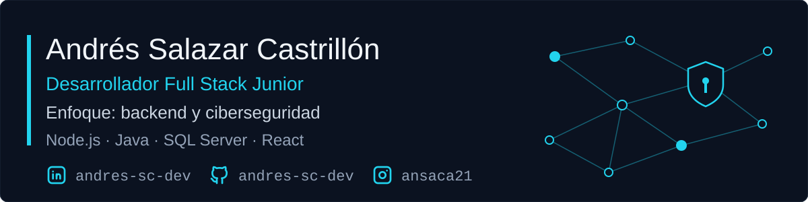

  

  &nbsp;&nbsp;
  &nbsp;&nbsp;
  

---

## STACK

| Área | Tecnologías |
|---|---|
| **Backend** |    |
| **Frontend y móvil** |     |
| **Bases de datos** |    |
| **Análisis de datos** |    |
| **Redes y seguridad** |  |
| **Herramientas** |   |

## CERTIFICACIONES

| Certificación | Emisor |
|---|---|
| Introduction to Cybersecurity | Cisco Networking Academy |
| Networking Basics | Cisco Networking Academy |
| [Bootcamp de Análisis de Datos (159 h)](https://www.auco.ai/verify/?code=AX76QZUPSY) | Talento Tech · MinTIC · IU Training |
| HTML and JavaScript Essentials | Cisco Networking Academy |
| Introducción al desarrollo con IA | BIG School |

## PROYECTOS

| Proyecto | Descripción | Stack |
|---|---|---|
| [EnglishClassBookings](https://github.com/andres-sc-dev/EnglishClassBookings) | App móvil de reservas de clases de inglés | React Native · Expo |

---

Ciberseguridad Junior Trainee · Desarrollador Junior · andres.sc.dev@gmail.com

